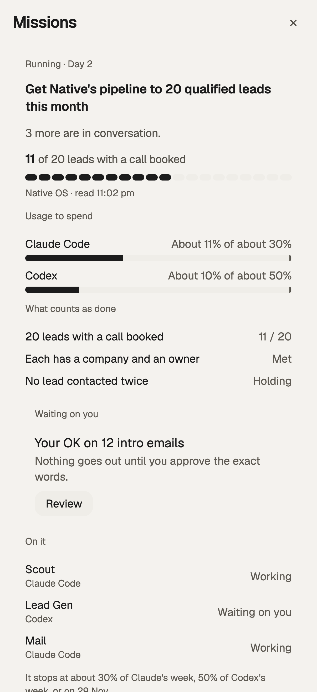
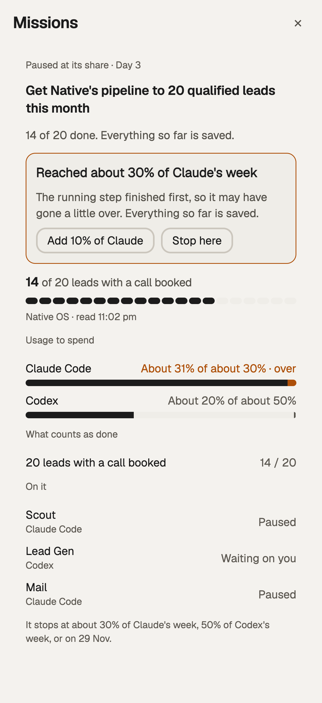
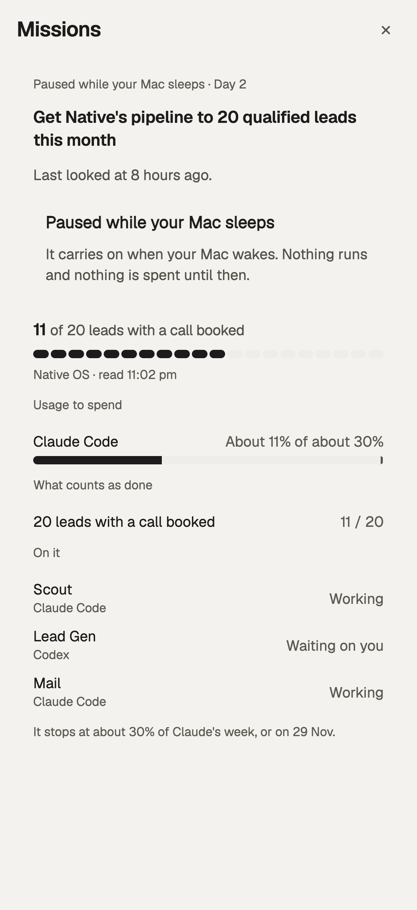
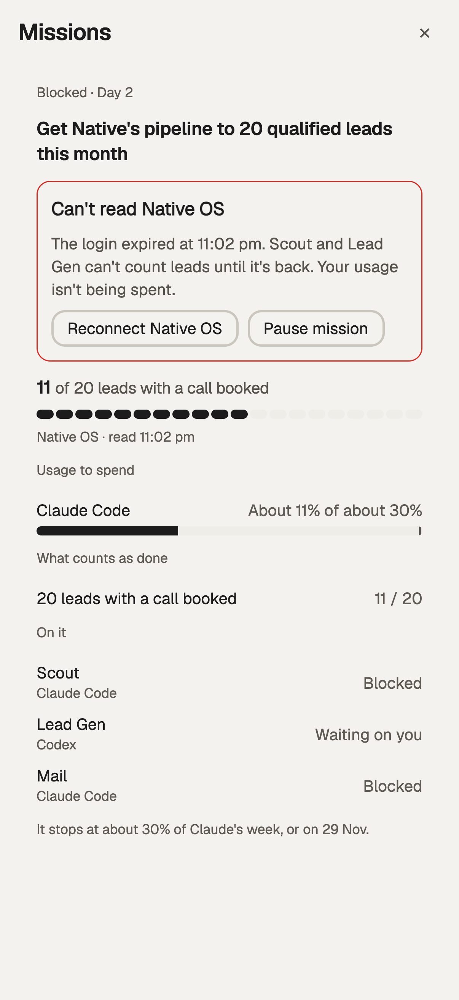
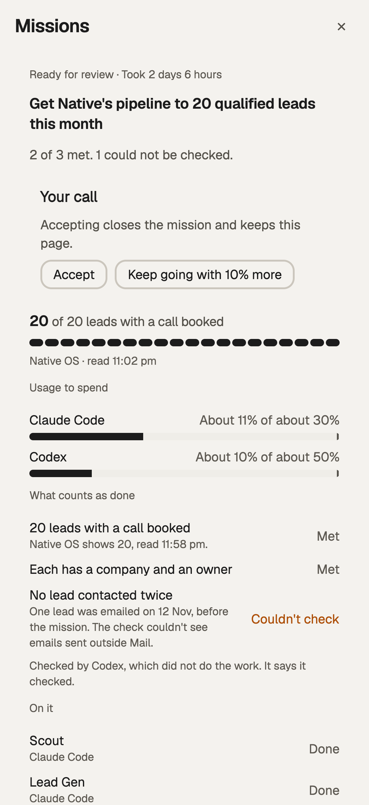
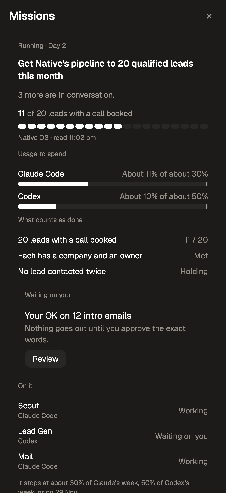
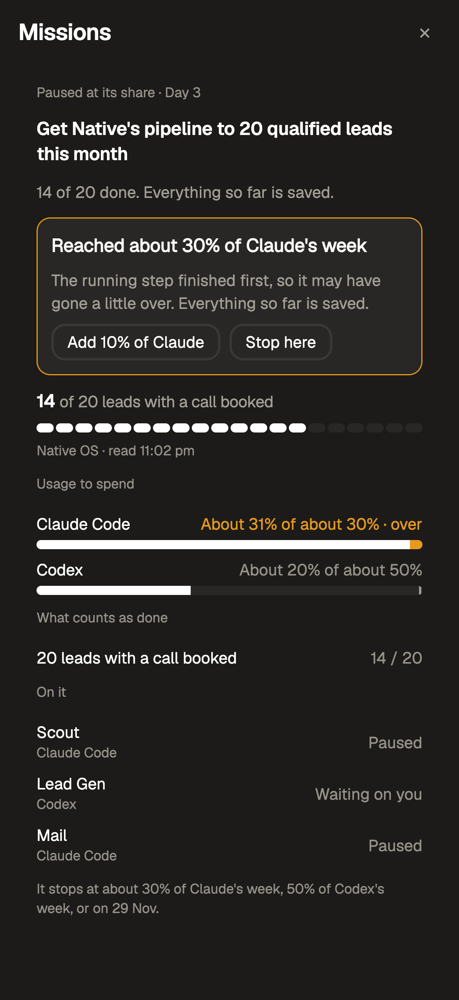
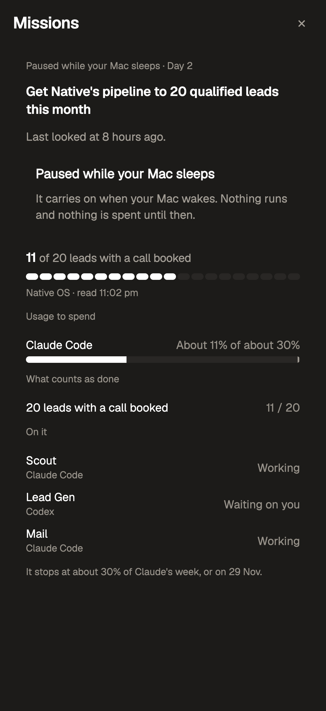
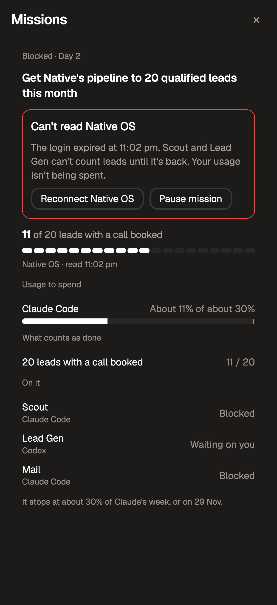
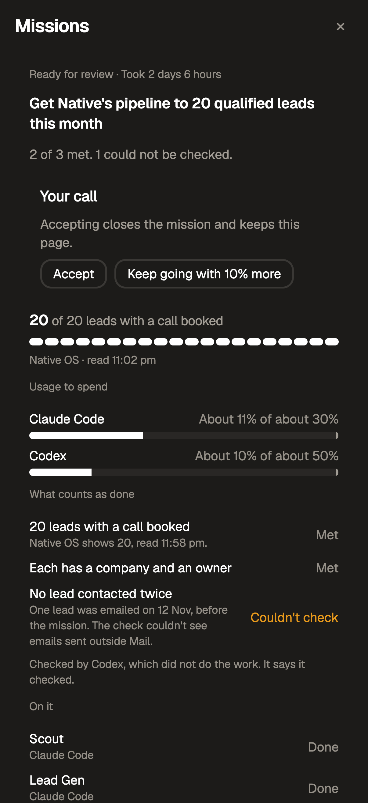

# Phone screens (web build)

10 shots at 402×874 @3x, themes: light, dark. Took 83 s.

Web-only artifacts to ignore: the tab bar is a pill at the top, there are no safe areas or
iOS large titles, icons are Material Symbols, images behind auth are grey. See docs/mobile.md.

## probe-mission-running-light

- Route: `/missions?id=m-standard`
- Check: Running, day 2: “11 of 20 leads with a call booked”, 11 of 20 ticks lit; Claude Code “About 11% of about 30%”, Codex “About 10% of about 50%”; Waiting on you with one ask and a real Review button; three agents with their engines; the note “It stops at about 30% of Claude’s week, 50% of Codex’s week, or on …”; Pause

## probe-mission-over-cap-light

- Route: `/missions?id=m-over-cap`
- Check: Amber banner “Reached about 30% of Claude’s week” with Add 10% of Claude and Stop here; Claude’s share “About 31% of about 30% · over” with amber beyond the marker; agents say Paused

## probe-mission-asleep-light

- Route: `/missions?id=m-asleep`
- Check: Chip and banner both say “Paused while your Mac sleeps”, no buttons and no Pause; the last numbers read; never “Running”

## probe-mission-blocked-light

- Route: `/missions?id=m-blocked`
- Check: Red-outlined banner “Can’t read Native OS” saying who it affects and that usage isn’t being spent, with Reconnect Native OS and Pause mission

## probe-mission-done-light

- Route: `/missions?id=m-done`
- Check: Ready for review, “Took 2 days 6 hours”: “Your call” with Accept; 20 of 20; the note “It used about 11% of Claude’s week, 10% of Codex’s week. Nothing more is spent.”; agents say Done

## probe-mission-running-dark

- Route: `/missions?id=m-standard`
- Check: Running, day 2: “11 of 20 leads with a call booked”, 11 of 20 ticks lit; Claude Code “About 11% of about 30%”, Codex “About 10% of about 50%”; Waiting on you with one ask and a real Review button; three agents with their engines; the note “It stops at about 30% of Claude’s week, 50% of Codex’s week, or on …”; Pause

## probe-mission-over-cap-dark

- Route: `/missions?id=m-over-cap`
- Check: Amber banner “Reached about 30% of Claude’s week” with Add 10% of Claude and Stop here; Claude’s share “About 31% of about 30% · over” with amber beyond the marker; agents say Paused

## probe-mission-asleep-dark

- Route: `/missions?id=m-asleep`
- Check: Chip and banner both say “Paused while your Mac sleeps”, no buttons and no Pause; the last numbers read; never “Running”

## probe-mission-blocked-dark

- Route: `/missions?id=m-blocked`
- Check: Red-outlined banner “Can’t read Native OS” saying who it affects and that usage isn’t being spent, with Reconnect Native OS and Pause mission

## probe-mission-done-dark

- Route: `/missions?id=m-done`
- Check: Ready for review, “Took 2 days 6 hours”: “Your call” with Accept; 20 of 20; the note “It used about 11% of Claude’s week, 10% of Codex’s week. Nothing more is spent.”; agents say Done

