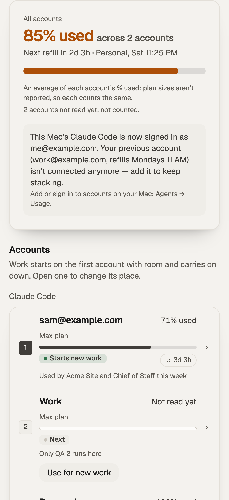
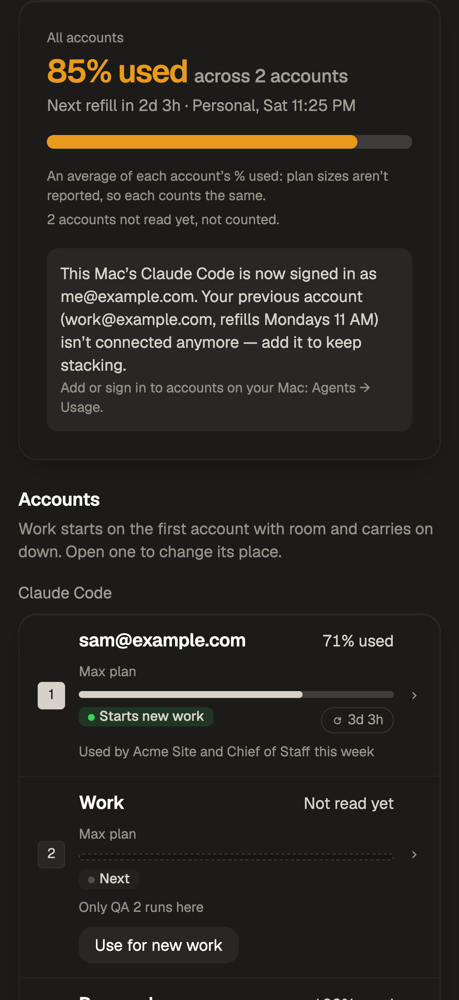
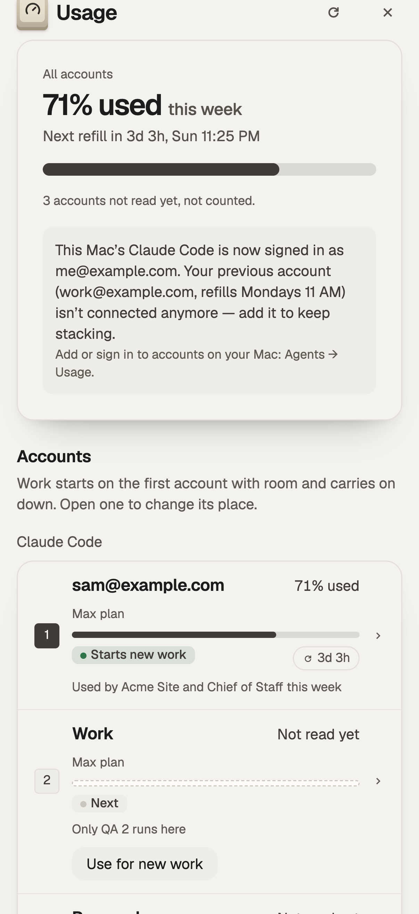
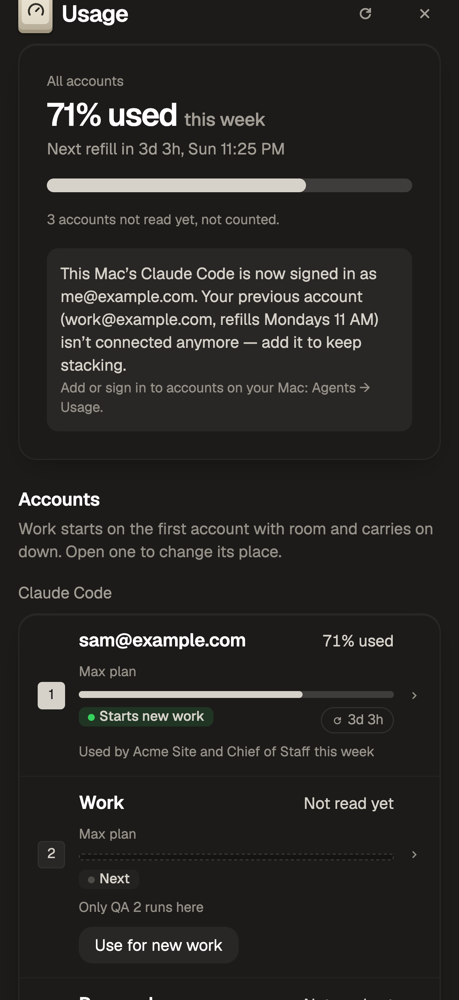
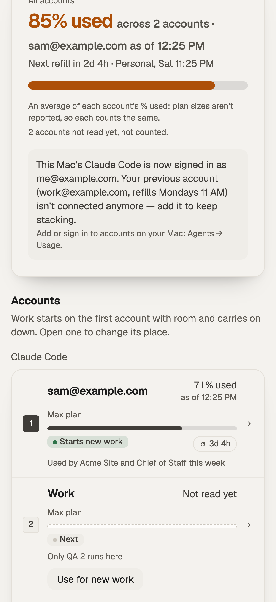
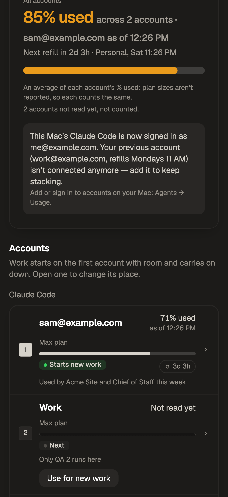

# Phone screens (web build)

6 shots at 402×874 @3x, themes: light, dark. Took 70 s.

Web-only artifacts to ignore: the tab bar is a pill at the top, there are no safe areas or
iOS large titles, icons are Material Symbols, images behind auth are grey. See docs/mobile.md.

## usage-accounts-two-claude-light

- Route: `/usage?id=site`
- Check: Your accounts: a sheet with one headline, ONE bar of the total (an unread account left out of it and said so, never a segment per account) and the next refill; then each account as a card: a numbered keycap (the one in use filled), its name, plan and who, a state pill ("In use", "Out of usage until …", "Not signed in"), its 5-hour and Weekly bars with "Resets in …", and a pace line in secondary ink (never amber) when the Mac sent one; no account named "This Mac". In the stale variant the Mac's figures say "as of <a time 7 hours ago>" (headline and its card), the other account's do not

## usage-accounts-two-claude-dark

- Route: `/usage?id=site`
- Check: Your accounts: a sheet with one headline, ONE bar of the total (an unread account left out of it and said so, never a segment per account) and the next refill; then each account as a card: a numbered keycap (the one in use filled), its name, plan and who, a state pill ("In use", "Out of usage until …", "Not signed in"), its 5-hour and Weekly bars with "Resets in …", and a pace line in secondary ink (never amber) when the Mac sent one; no account named "This Mac". In the stale variant the Mac's figures say "as of <a time 7 hours ago>" (headline and its card), the other account's do not

## usage-accounts-one-read-light

- Route: `/usage?id=site`
- Check: Your accounts: a sheet with one headline, ONE bar of the total (an unread account left out of it and said so, never a segment per account) and the next refill; then each account as a card: a numbered keycap (the one in use filled), its name, plan and who, a state pill ("In use", "Out of usage until …", "Not signed in"), its 5-hour and Weekly bars with "Resets in …", and a pace line in secondary ink (never amber) when the Mac sent one; no account named "This Mac". In the stale variant the Mac's figures say "as of <a time 7 hours ago>" (headline and its card), the other account's do not

## usage-accounts-one-read-dark

- Route: `/usage?id=site`
- Check: Your accounts: a sheet with one headline, ONE bar of the total (an unread account left out of it and said so, never a segment per account) and the next refill; then each account as a card: a numbered keycap (the one in use filled), its name, plan and who, a state pill ("In use", "Out of usage until …", "Not signed in"), its 5-hour and Weekly bars with "Resets in …", and a pace line in secondary ink (never amber) when the Mac sent one; no account named "This Mac". In the stale variant the Mac's figures say "as of <a time 7 hours ago>" (headline and its card), the other account's do not

## usage-accounts-stale-light

- Route: `/usage?id=site`
- Check: Your accounts: a sheet with one headline, ONE bar of the total (an unread account left out of it and said so, never a segment per account) and the next refill; then each account as a card: a numbered keycap (the one in use filled), its name, plan and who, a state pill ("In use", "Out of usage until …", "Not signed in"), its 5-hour and Weekly bars with "Resets in …", and a pace line in secondary ink (never amber) when the Mac sent one; no account named "This Mac". In the stale variant the Mac's figures say "as of <a time 7 hours ago>" (headline and its card), the other account's do not

## usage-accounts-stale-dark

- Route: `/usage?id=site`
- Check: Your accounts: a sheet with one headline, ONE bar of the total (an unread account left out of it and said so, never a segment per account) and the next refill; then each account as a card: a numbered keycap (the one in use filled), its name, plan and who, a state pill ("In use", "Out of usage until …", "Not signed in"), its 5-hour and Weekly bars with "Resets in …", and a pace line in secondary ink (never amber) when the Mac sent one; no account named "This Mac". In the stale variant the Mac's figures say "as of <a time 7 hours ago>" (headline and its card), the other account's do not

